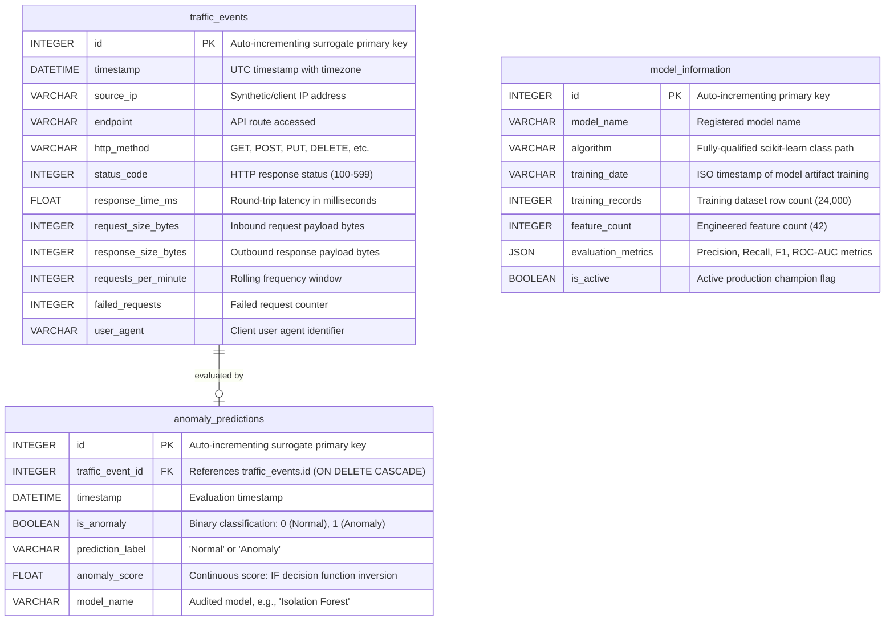

# AegisAPI – Database Architecture & SQLite Integration Documentation

This document provides a comprehensive reference for the database persistence layer implemented in **Phase 5** of the AegisAPI platform.

---

## 1. Overview & Technology Stack

The AegisAPI persistence architecture is built using **SQLite** managed via the **SQLAlchemy 2.0 ORM**.

- **Database Engine:** SQLite 3 (`backend/aegisapi.db`)
- **ORM / Abstraction Layer:** SQLAlchemy 2.0 (`app.models.Base`)
- **Connection Model:** Thread-safe connection pooling configured with `check_same_thread=False` to support asynchronous FastAPI coroutines across multi-worker environments.
- **Session Management:** Scoped dependency injection generator (`get_db`) yielding dedicated `SessionLocal` instances with guaranteed teardown (`finally: db.close()`).
- **Data Integrity:** Foreign key constraints (`PRAGMA foreign_keys = ON`), atomic transactions with rollback protection, and savepoint-isolated batch inserts.

---

## 2. Database Schema & Tables

The database schema models high-throughput API telemetry, real-time machine learning threat predictions, and machine learning governance metadata across three core tables:



---

## 3. Detailed Table Specifications

### A. `traffic_events` Table

Stores raw and pre-inference API telemetry ingested through the detection pipeline.

| Column | Data Type | Nullable | Constraints & Defaults | Description |
| :--- | :--- | :---: | :--- | :--- |
| `id` | `INTEGER` | No | Primary Key, Auto-increment | Unique telemetry event identifier |
| `timestamp` | `DATETIME` | No | Indexed, Default: UTC `now()` | Ingestion timestamp |
| `source_ip` | `VARCHAR(45)` | No | Indexed, Default: `'127.0.0.1'` | Inbound client IPv4/IPv6 address |
| `endpoint` | `VARCHAR(255)`| No | Indexed | Targeted API route (e.g. `/api/v1/auth/login`) |
| `http_method` | `VARCHAR(10)` | No | Uppercase check | HTTP Verb (`GET`, `POST`, `PUT`, `DELETE`) |
| `status_code` | `INTEGER` | No | `100 <= val <= 599` | Downstream HTTP response code |
| `response_time_ms` | `FLOAT` | No | `val >= 0.0` | API execution latency in milliseconds |
| `request_size_bytes` | `INTEGER` | No | Default: `0` | Request body length in bytes |
| `response_size_bytes` | `INTEGER` | No | Default: `0` | Response body length in bytes |
| `requests_per_minute` | `INTEGER` | No | Default: `1` | Source IP request rate in rolling 60s window |
| `failed_requests` | `INTEGER` | No | Default: `0` | Sequential client error count |
| `user_agent` | `VARCHAR(255)`| Yes | Default: `'Unknown'` | Browser or tooling user-agent string |

### B. `anomaly_predictions` Table

Stores machine learning inference results generated by the active champion model.

| Column | Data Type | Nullable | Constraints & Defaults | Description |
| :--- | :--- | :---: | :--- | :--- |
| `id` | `INTEGER` | No | Primary Key, Auto-increment | Unique prediction record ID |
| `traffic_event_id`| `INTEGER` | No | Foreign Key (`traffic_events.id`), Unique, Indexed | Link to parent telemetry event (`ON DELETE CASCADE`) |
| `timestamp` | `DATETIME` | No | Default: UTC `now()` | Model scoring timestamp |
| `is_anomaly` | `BOOLEAN` | No | Indexed | Target classification (True = Anomaly) |
| `prediction_label`| `VARCHAR(50)` | No | Indexed | Human-readable label (`Normal` or `Anomaly`) |
| `anomaly_score` | `FLOAT` | No | Indexed | Continuous outlier score (positive = anomaly) |
| `model_name` | `VARCHAR(100)`| No | Default: `'Isolation Forest'` | Name of model generating inference |

### C. `model_information` Table

Maintains an immutable audit ledger of model deployments, active champion state, and offline benchmark validation results.

| Column | Data Type | Nullable | Constraints & Defaults | Description |
| :--- | :--- | :---: | :--- | :--- |
| `id` | `INTEGER` | No | Primary Key, Auto-increment | Model registration identifier |
| `model_name` | `VARCHAR(100)`| No | Indexed | Registered identifier (e.g., `'Isolation Forest'`) |
| `algorithm` | `VARCHAR(150)`| No | - | Class path (`sklearn.ensemble._iforest.IsolationForest`) |
| `training_date` | `VARCHAR(50)` | Yes | - | Training completion timestamp |
| `training_records`| `INTEGER` | No | Default: `0` | Number of training rows (24,000) |
| `feature_count` | `INTEGER` | No | Default: `0` | Total feature dimensions (42) |
| `evaluation_metrics`| `JSON` | Yes | SQLite JSON / text column | Validation metrics (Precision, Recall, F1, ROC-AUC) |
| `is_active` | `BOOLEAN` | No | Default: `True`, Indexed | Flags current active inference model |

---

## 4. Relationships, Cascades, and Indexing

### 1-to-1 Telemetry-to-Prediction Relationship
- `TrafficEvent.prediction` establishes a bidirectional 1-to-1 relationship with `AnomalyPrediction.traffic_event`.
- `cascade="all, delete-orphan"` guarantees that purging or trimming telemetry records automatically cascades to remove dependent prediction rows without manual cleanup.

### Indexing Strategy
To ensure sub-millisecond query latency across dashboard views and analytics queries, targeted single and composite indexes are defined:
1. `ix_traffic_events_timestamp` on `traffic_events(timestamp DESC)` for high-speed chronological sorting.
2. `ix_traffic_events_endpoint` on `traffic_events(endpoint)` for rapid per-route aggregation.
3. `ix_traffic_events_source_ip` on `traffic_events(source_ip)` for volumetric threat tracing.
4. `ix_anomaly_predictions_is_anomaly` on `anomaly_predictions(is_anomaly)` for fast security incident filtering.
5. `ix_anomaly_predictions_traffic_event_id` for instantaneous JOIN resolutions between telemetry and threat labels.

---

## 5. Automated Initialization & Idempotency

Database initialization is orchestrated via `init_db()` in `backend/app/database.py`.

```python
def init_db(custom_engine=None):
    Base.metadata.create_all(bind=target_engine)
```

### Startup Flow:
1. When the FastAPI application boots (`lifespan` context manager in `backend/app/main.py`), `init_db()` executes before handling any inbound network traffic.
2. If `backend/aegisapi.db` does not exist, SQLite creates the file and sets up all tables and indexes.
3. `init_db()` inspects `models/model_metadata.json` and checks if the active model is registered in `model_information`.
4. If absent, it automatically registers the champion Isolation Forest configuration, training parameters, and evaluation metrics (Precision: 99.88%, Recall: 99.78%, F1: 99.83%, ROC-AUC: 99.98%).
5. Subsequent boots verify registration idempotently, preventing duplicate audit entries.

---

## 6. Common Database Operations & Queries

The database layer is managed through `DatabaseService` (`backend/app/services/database_service.py`).

### 1. Atomic Transaction (Save Telemetry + Prediction)
```python
from app.services.database_service import database_service

event, prediction = database_service.save_traffic_and_prediction(
    db=session,
    record=incoming_traffic_record,
    prediction=inference_response,
)
```

### 2. Paginated Chronological Telemetry Retrieval
```python
# Fetches newest 50 events eagerly joining prediction results
events = database_service.get_recent_traffic(db=session, limit=50, offset=0)
```

### 3. Incident Filtering (Anomalies Only)
```python
# Fetches newest flagged threat incidents with source IP and route details
anomalies = database_service.get_recent_anomalies(db=session, limit=50, offset=0)
```

### 4. Real-Time Dashboard Aggregation
```python
# Computes total volume, anomaly counts, failure rates, and top attacked endpoints via SQL
stats = database_service.calculate_statistics(db=session)
```

---

## 7. Safe Data Reset & Maintenance Procedure

To perform a clean wipe of stored telemetry without corrupting the application:

### Option A: Using SQLite CLI or Python Script
```python
from app.database import SessionLocal
from app.models import TrafficEvent, AnomalyPrediction

db = SessionLocal()
try:
    # Cascading foreign keys allow deleting TrafficEvent to wipe AnomalyPrediction
    db.query(AnomalyPrediction).delete()
    db.query(TrafficEvent).delete()
    db.commit()
    print("Telemetry database wiped successfully.")
finally:
    db.close()
```

### Option B: Cold Storage Reset
1. Stop the FastAPI backend service (`uvicorn` process).
2. Delete `backend/aegisapi.db`.
3. Restart the FastAPI service:
   ```bash
   uvicorn app.main:app --reload
   ```
4. `init_db()` will recreate a clean database file and re-seed active model metadata automatically.

