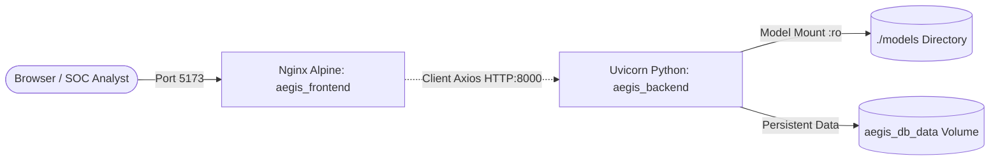

# AegisAPI – Production Deployment & Operations Guide

This guide details the deployment options, environment variables, Docker orchestration, and maintenance procedures for the **AegisAPI – Intelligent API Traffic Anomaly Detection & Threat Monitoring Platform**.

---

## 1. System Requirements

### Hardware Prerequisites
- **CPU:** Minimum 2 cores (4+ cores recommended for high-frequency traffic ingestion).
- **RAM:** Minimum 2 GB (4 GB recommended for concurrent batch scoring).
- **Disk Storage:** Minimum 500 MB for application, dependencies, model artifacts, and SQLite storage.

### Software Prerequisites
- **Python:** 3.11, 3.12, or 3.13
- **Node.js:** 18.x, 20.x, or 24.x (with npm 9+)
- **Docker & Docker Compose:** Docker Engine 24+ and Compose v2+ (optional for containerized deployment)

---

## 2. Environment Variables Configuration

| Variable Name | Default Value | Context | Description |
| :--- | :--- | :---: | :--- |
| `DATABASE_URL` | `sqlite:///backend/aegisapi.db` | Backend | SQLite connection string URI. |
| `MODELS_DIR` | `models/` (relative to root) | Backend | Path to serialized ML model artifacts and schema JSON. |
| `ENVIRONMENT` | `production` | Backend | Operational mode (`development` or `production`). |
| `VITE_API_BASE_URL` | `http://localhost:8000` | Frontend | Target backend URL for Axios client. |
| `VITE_POLLING_INTERVAL_MS`| `12000` | Frontend | Telemetry polling frequency in milliseconds (12s). |

Template files are provided in `.env.example` at the repository root and `frontend/.env.example`.

---

## 3. Deployment Option A: Local Bare-Metal Execution

Recommended for evaluation, demonstration, and local security analysis.

### Step 1: Clone and Configure
```bash
git clone https://github.com/amank/AegisAPI.git
cd AegisAPI
```

### Step 2: Initialize Backend Environment
```bash
# Navigate to backend directory
cd backend

# Create virtual environment
python -m venv .venv

# Activate virtual environment
# Windows:
.venv\Scripts\activate
# Linux/macOS:
# source .venv/bin/activate

# Install dependencies
pip install -r requirements.txt

# Run automated tests to verify model loading & database initialization
pytest tests/ -v

# Start FastAPI backend service
uvicorn app.main:app --host 127.0.0.1 --port 8000 --reload
```
*Backend API and OpenAPI Documentation will be available at:* **`http://127.0.0.1:8000/docs`**

### Step 3: Initialize Frontend Dashboard (In a New Terminal)
```bash
cd frontend

# Install dependencies
npm install

# Build production bundle
npm run build

# Start development server
npm run dev
```
*Frontend SOC Dashboard will be accessible at:* **`http://localhost:5173`**

---

## 4. Deployment Option B: Multi-Container Docker Compose

Recommended for self-contained, reproducible deployment across Linux, macOS, and Windows Docker hosts.

### Container Architecture
- **`aegis_backend`:** Multi-stage Python 3.11-slim container running Uvicorn ASGI server with automated healthcheck.
- **`aegis_frontend`:** Multi-stage Nginx Alpine container serving optimized Vite static bundles on port 5173.
- **`aegis_db_data`:** Docker named volume maintaining persistent SQLite state across container restarts.



### Execution Commands
```bash
# Build and start all services in detached mode
docker compose up -d --build

# Inspect container status and healthchecks
docker compose ps

# View live system logs
docker compose logs -f

# Gracefully stop containers
docker compose down
```

---

## 5. Health Checks & Observability

Both containers integrate automated healthchecks:

- **Backend Health Check:**
  Queries `http://127.0.0.1:8000/health` every 15s. Returns 200 when Uvicorn is responsive and the Isolation Forest model artifact is loaded into memory:
  ```json
  {
    "status": "healthy",
    "service": "AegisAPI",
    "version": "0.1.0",
    "model_loaded": true,
    "model_name": "Isolation Forest",
    "feature_count": 42
  }
  ```
- **Frontend Health Check:**
  Queries `http://localhost/` via Nginx every 20s.

---

## 6. Database Backup & Maintenance

### Backup Procedure
To create an offline backup of stored telemetry and threat incidents:
```bash
# SQLite safe hot-backup command
sqlite3 backend/aegisapi.db ".backup 'backend/aegisapi_backup_$(date +%Y%m%d).db'"
```

### Resetting Telemetry Cleanly
To reset stored traffic without affecting model governance:
```bash
python -c "from app.database import SessionLocal; from app.models import TrafficEvent, AnomalyPrediction; db = SessionLocal(); db.query(AnomalyPrediction).delete(); db.query(TrafficEvent).delete(); db.commit(); db.close(); print('Telemetry wiped.')"
```

---

## 7. Known Operational Limits & Defensive Disclaimer

> [!CAUTION]
> **Defensive Telemetry Monitoring Prototype Notice:**
> AegisAPI is an intelligent **security monitoring, anomaly detection, and observational telemetry platform**.
> - It is **not** an inline attack-blocking engine or active firewall.
> - It does **not** terminate network connections or inject TCP reset packets.
> - High-frequency streaming exceeds 500 records/sec should be scaled horizontally behind a load balancer with Redis caching.

