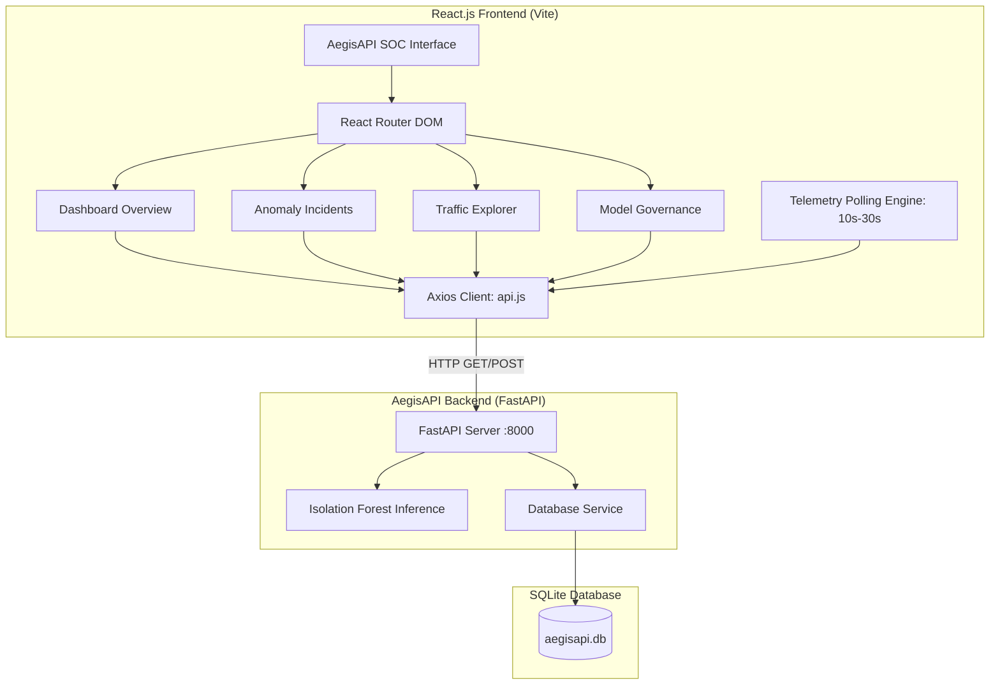

# AegisAPI – Frontend React Dashboard Documentation

This document provides a comprehensive technical guide for the **AegisAPI Cybersecurity SOC Dashboard** implemented in **Phase 6**.

---

## 1. Overview & Architecture

The AegisAPI frontend is an enterprise-grade Security Operations Center (SOC) web application built using **React 18**, **Vite 5**, **Tailwind CSS 3**, and **Recharts**. It provides security analysts and operators with real-time visual observability, incident exploration, and model governance insights for API telemetry.



---

## 2. Technology Stack

| Library / Tool | Version | Purpose |
| :--- | :---: | :--- |
| **React** | `^18.3.1` | Component-based user interface architecture |
| **Vite** | `^5.4.9` | High-speed frontend bundling, HMR, and build optimization |
| **Tailwind CSS** | `^3.4.14` | Utility-first styling with dark navy cybersecurity theme (`#080C14`) |
| **Recharts** | `^2.13.0` | SVG-based responsive data visualization for traffic trends |
| **Axios** | `^1.7.7` | HTTP client with normalized error handling and timeout interception |
| **React Router** | `^6.27.0` | Client-side declarative routing and SPA navigation |
| **Lucide React** | `^0.453.0` | Cybersecurity and operational system iconography |

---

## 3. Pages & Features

### 1. Dashboard Overview (`/`)
- **6 Real-Time KPI Cards:**
  1. *Total API Requests:* Ingested telemetry count.
  2. *Normal Requests:* Benign traffic count.
  3. *Detected Anomalies:* Security incidents flagged by Isolation Forest.
  4. *Anomaly Percentage:* Proportion of anomalous traffic streams.
  5. *Average Response Time:* Global latency across monitored endpoints.
  6. *HTTP Error Count:* 4xx client and 5xx server failure counts.
- **Interactive Visualizations:**
  - *Traffic Velocity & Volume:* Rolling RPM over time with gradient area fill.
  - *Normal vs Anomalous Distribution:* Donut chart displaying threat proportions.
  - *API Latency Trends:* Line chart displaying response delays with average baseline.
  - *HTTP Status Code Breakdown:* Bar chart color-coded by HTTP class (2xx emerald, 4xx amber, 5xx rose).
  - *Top API Endpoints:* Ingestion volume by API route.
- **Recent Incident Feed:** Quick-look table showing the newest 5 flagged threats.

### 2. Anomaly Incidents Monitoring (`/anomalies`)
- **Dedicated Threat Inspection Table:** Lists all flagged anomalies with timestamp, source IP, method, route, HTTP status, latency, raw continuous anomaly score, threat tier badge, and model name.
- **Search & Filters:**
  - Search by route, source IP, or HTTP method.
  - Filter by HTTP status (All, 2xx, 4xx, 5xx).
  - Filter by Threat Tier (`Critical`, `High`, `Medium`, `Low`).
  - Chronological sort toggle (`Newest First` / `Oldest First`).
- **Score Integrity:** Preserves the raw continuous Isolation Forest decision offset without artificial probability conversions.

### 3. API Traffic Explorer (`/traffic`)
- **Historical Telemetry Table:** Complete chronological audit log of all inbound API traffic.
- **Telemetry Attributes:** Timestamp, client IP, method, endpoint, status code, latency, inbound payload size, outbound response size, request frequency (RPM), and prediction status.
- **Search & Filter:** Search by IP or endpoint; filter by verdict (`All`, `Normal`, `Anomalous`) or HTTP method (`GET`, `POST`, `PUT`, `DELETE`).
- **Pagination:** Clean page-based pagination with customizable view window.

### 4. ML Model Information & Governance (`/model-info`)
- **Champion Model Metadata:** Algorithm class path, training date, training records (24,000), and feature count (42).
- **Offline Benchmark Evaluation Metrics:**
  - *Precision:* 99.88%
  - *Recall:* 99.78%
  - *F1-Score:* 99.83%
  - *ROC-AUC:* 99.98%
- **Governance Notice:** Prominent banner emphasizing that metrics represent stratified offline test-set evaluation (6,000 held-out samples), not dynamic real-time traffic accuracy.
- **Hyperparameters:** Discloses ensemble configuration (`n_estimators: 100`, `contamination: 0.15`, `max_samples: 1.0`, `random_state: 42`).
- **Engineered Feature Schema:** Complete taxonomy of all 42 input features.

### 5. Interactive Simulation Modal
- Operators can trigger simulated traffic vectors right from the top navigation bar:
  - *Benign Product Catalog Request* (GET /api/v1/products)
  - *Authentication Brute-Force Burst* (POST /api/v1/auth/login)
  - *Large Payload Data Exfiltration* (GET /api/v1/users/export)
  - *Volumetric Rate Spike (DDoS)* (GET /api/v1/search)
- Displays immediate model scoring and updates the SQLite database and live dashboard feeds.

---

## 4. Reusable Component Hierarchy

```text
frontend/src/
├── components/
│   ├── layout/
│   │   ├── Sidebar.jsx              # Navigation links, branding, Swagger link
│   │   ├── Topbar.jsx               # System health pill, polling controls, simulation modal trigger
│   │   └── Layout.jsx               # Responsive shell wrapping sidebar and main content
│   ├── common/
│   │   ├── MetricCard.jsx           # KPI card with cyber glow, icons, and badges
│   │   ├── DataTable.jsx            # Reusable table with custom cell rendering and pagination
│   │   ├── ThreatBadge.jsx          # Color-coded badge (Safe, Low, Medium, High, Critical)
│   │   ├── MethodBadge.jsx          # Monospaced badge for HTTP methods
│   │   ├── LoadingState.jsx         # Radar pulse animation for loading transitions
│   │   ├── ErrorState.jsx           # Error card with retry button and diagnostics
│   │   └── EmptyState.jsx           # Clean placeholder when queries return zero results
│   ├── charts/
│   │   ├── TrafficVolumeChart.jsx   # Area chart for requests per minute over time
│   │   ├── NormalVsAnomalyChart.jsx # Donut chart comparing normal vs anomalous requests
│   │   ├── ResponseTimeChart.jsx    # Line chart showing round-trip latencies and avg line
│   │   ├── StatusDistributionChart.jsx # Bar chart of HTTP response status codes
│   │   └── EndpointDistributionChart.jsx # Horizontal bar chart of top accessed endpoints
│   └── modals/
│       └── TestPredictionModal.jsx  # Interactive modal for live simulated traffic evaluation
```

---

## 5. API Integration & Polling Mechanism

API communication is centralized in [`frontend/src/services/api.js`](file:///c:/Users/amank/OneDrive/Desktop/AegisAPI/frontend/src/services/api.js):

```javascript
import axios from 'axios';

const API_BASE_URL = import.meta.env.VITE_API_BASE_URL || 'http://127.0.0.1:8000';
```

### Configurable Polling Engine:
- **Interval:** Default 12,000 ms (12 seconds), configurable via topbar selector (`10s`, `15s`, `30s`, or `Manual`).
- **Overlapping Request Guard:** Implemented with `useRef(isFetchingRef)` to prevent cascading requests over slow networks.
- **Teardown Cleanup:** All intervals are cleared on unmount via `useEffect` cleanup return.
- **Zero-Falsification Policy:** When backend queries fail or return empty datasets, the UI renders explicit `ErrorState` or `EmptyState` components rather than fabricating fake telemetry values.

---

## 6. Environment Setup & Execution Commands

### Prerequisites
- **Node.js:** v18.0.0+ (Tested on v24.14.0)
- **npm:** v9.0.0+ (Tested on v11.9.0)

### Configuration
Create `frontend/.env` from the provided example:
```bash
cp frontend/.env.example frontend/.env
```

Contents of `.env`:
```env
VITE_API_BASE_URL=http://127.0.0.1:8000
VITE_POLLING_INTERVAL_MS=12000
```

### Running the Application

1. **Start the FastAPI Backend Service (Terminal 1):**
   ```bash
   cd backend
   .venv\Scripts\uvicorn app.main:app --host 127.0.0.1 --port 8000 --reload
   ```

2. **Start the Vite Frontend Development Server (Terminal 2):**
   ```bash
   cd frontend
   npm run dev
   ```
   The dashboard will be accessible at: **`http://localhost:5173`**

3. **Building for Production:**
   ```bash
   cd frontend
   npm run build
   ```
   Production assets will be emitted to `frontend/dist/`.

