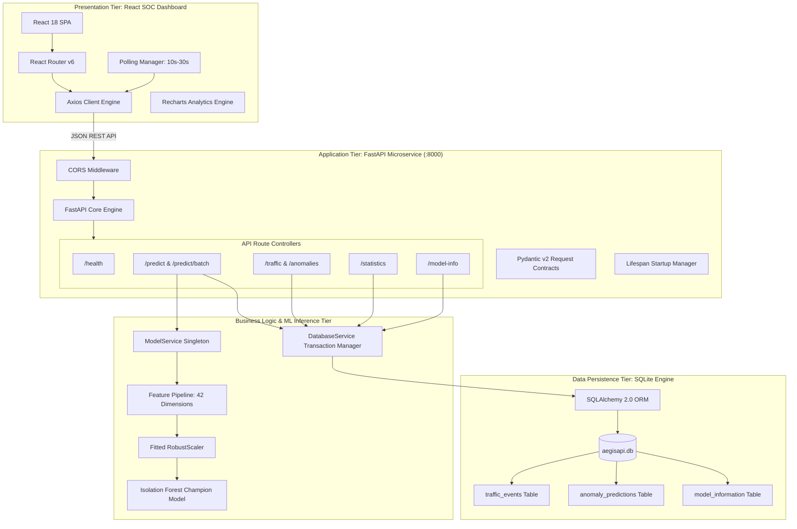
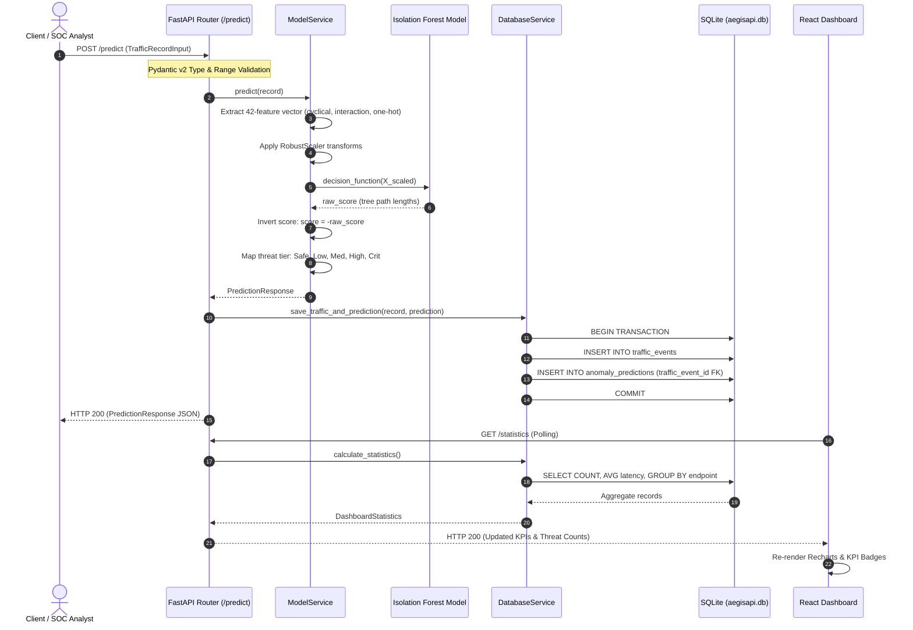

# AegisAPI – System Architecture & Technical Design Specification

This document details the architectural principles, component interactions, machine learning pipeline, data models, and security boundaries of the **AegisAPI** security monitoring platform.

---

## 1. High-Level System Architecture

AegisAPI is structured as a decoupled, multi-tier security telemetry observability platform:



---

## 2. End-to-End Ingestion & Inference Sequence

The following sequence details how telemetry flows from ingestion through model inference to persistent storage and presentation:



---

## 3. Feature Engineering Pipeline (42 Dimensions)

The ML inference service transforms 10 raw API telemetry attributes into an engineered 42-dimensional feature matrix:

```mermaid
graph LR
    subgraph RawAttributes["Raw Telemetry Input (10 fields)"]
        direction TB
        F_TS[timestamp]
        F_MET[http_method]
        F_EP[endpoint]
        F_SC[status_code]
        F_LAT[response_time_ms]
        F_REQ[request_size_bytes]
        F_RES[response_size_bytes]
        F_RPM[requests_per_minute]
        F_FAIL[failed_requests]
        F_IP[source_ip]
    end

    subgraph FeaturePipeline["Deterministic Preprocessing Pipeline"]
        direction TB
        T1[Cyclical Hour: sin/cos 24h]
        T2[Cyclical Day: sin/cos 7d]
        T3[Domain Ratios: payload_ratio, fail_ratio, size_to_time]
        T4[Status Flags: is_4xx, is_5xx, is_error]
        T5[Numerical Scaling: RobustScaler]
        T6[One-Hot Encodings: 4 Methods + 20 Endpoints]
    end

    subgraph ModelMatrix["Model Feature Vector (42 Features)"]
        X[Matrix X: Shape 1 x 42]
    end

    RawAttributes --> FeaturePipeline
    FeaturePipeline --> ModelMatrix
```



### Feature Group Breakdown:
1. **Continuous Telemetry & Ratios (8 features):** `response_time_ms`, `request_size_bytes`, `response_size_bytes`, `requests_per_minute`, `failed_requests`, `payload_ratio` (req/resp size), `failure_ratio` (failed/rpm), `size_to_time_ratio` (bytes/ms).
2. **Temporal Cyclical Transformations (4 features):** `hour_sin`, `hour_cos` ($2\pi \cdot \text{hour}/24$), `day_sin`, `day_cos` ($2\pi \cdot \text{day}/7$) to preserve cyclic boundary continuity between 23:59 and 00:00.
3. **HTTP Status Code Encodings (5 features):** `status_code`, `is_error` ($\ge 400$), `is_client_error` ($400-499$), `is_server_error` ($\ge 500$), `is_success` ($200-299$).
4. **HTTP Verb One-Hot Encodings (4 features):** `method_GET`, `method_POST`, `method_PUT`, `method_DELETE`.
5. **Endpoint One-Hot Encodings (20 features):** One-hot boolean flags for each monitored API route.
6. **Interaction & Rate Features (1 feature):** `request_frequency_spike_score`.

---

## 4. Machine Learning Mathematical Formulation

AegisAPI employs an **ensemble of Isolation Trees (iTrees)** to isolate anomalies based on the principle that abnormal observations require fewer random recursive partitions to isolate from nominal clusters.

### Average Path Length $c(n)$
For a dataset with $n$ instances, the average path length of an unsuccessful search in a Binary Search Tree (BST) is:
$$c(n) = 2 \ln(n - 1) + 0.5772156649 \text{ (Euler-Mascheroni constant)} - \frac{2(n - 1)}{n}$$

### Anomaly Score $s(x, n)$
The raw anomaly score of an instance $x$ over an ensemble of $k$ trees is computed as:
$$s(x, n) = 2^{-\frac{E(h(x))}{c(n)}}$$
where $E(h(x))$ is the expectation of path lengths $h(x)$ across all trees.

### AegisAPI Decision Score Inversion
Scikit-learn's `decision_function` returns:
$$\text{decision\_function}(x) = 0.5 - s(x, n)$$
AegisAPI inverts this value to align with cybersecurity conventions (higher positive values denote higher risk):
$$\text{Anomaly Score} = -\text{decision\_function}(x)$$

```
Nominal Cluster -------------------- Outlier Threshold --------------------> Extreme Threat
Score < 0.00                         Score = 0.00                            Score >= 0.25
[Safe / Nominal Traffic]             [Boundary]                              [Critical Incident]
```

---

## 5. Persistence & Data Integrity Architecture

The persistence layer uses SQLite managed through SQLAlchemy 2.0 ORM with foreign key cascades:

```
+-------------------------------------------------------------------------+
|                               SQLITE SCHEMA                             |
+-------------------------------------------------------------------------+
|                                                                         |
|  +------------------------+             +----------------------------+  |
|  |     traffic_events     |             |    anomaly_predictions     |  |
|  +------------------------+             +----------------------------+  |
|  | PK  id                 |<----+       | PK  id                     |  |
|  | IX  timestamp          |     |       | FK  traffic_event_id       |--+
|  | IX  source_ip          |     +-------| IX  timestamp              |
|  | IX  endpoint           |             | IX  is_anomaly             |
|  |     http_method        | 1-to-1      | IX  prediction_label       |
|  |     status_code        | CASCADE     | IX  anomaly_score          |
|  |     response_time_ms   |             |     model_name             |
|  |     request_size_bytes |             +----------------------------+  |
|  |     response_size_bytes|                                             |
|  |     requests_per_minute|             +----------------------------+  |
|  |     failed_requests    |             |     model_information      |  |
|  |     user_agent         |             +----------------------------+  |
|  +------------------------+             | PK  id                     |  |
|                                         | IX  model_name             |  |
|                                         |     algorithm              |  |
|                                         |     training_date          |  |
|                                         |     training_records       |  |
|                                         |     feature_count          |  |
|                                         |     evaluation_metrics     |  |
|                                         | IX  is_active              |  |
|                                         +----------------------------+  |
+-------------------------------------------------------------------------+
```

---

## 6. Security Boundaries & Prototype Constraints

> [!WARNING]
> **Defensive Telemetry Monitoring Prototype Notice:**
> AegisAPI is designed and validated as a **defensive security monitoring, anomaly detection, and forensic telemetry platform**. It is **not** an inline Web Application Firewall (WAF) or intrusion prevention system (IPS) and does **not** terminate network connections or execute packet-level drops.

### Enforced Security Controls:
1. **Strict Input Contracts:** All incoming payloads are validated against Pydantic v2 boundary constraints ($100 \le \text{status} \le 599$, $\text{latency} \ge 0$, $\text{payload} \ge 0$).
2. **CORS Boundary:** Configured with explicit origins and headers for development and production dashboard communication.
3. **SQL Injection Immunity:** Zero raw SQL queries; all persistence operations utilize parameterized ORM queries via SQLAlchemy 2.0.
4. **Transaction Savepoint Isolation:** Batch processing uses nested savepoints (`begin_nested()`) preventing single malformed items from corrupting batches.
5. **No Model Memory Corruption:** Model weights and scaler artifacts are loaded into immutable read-only memory structures.

